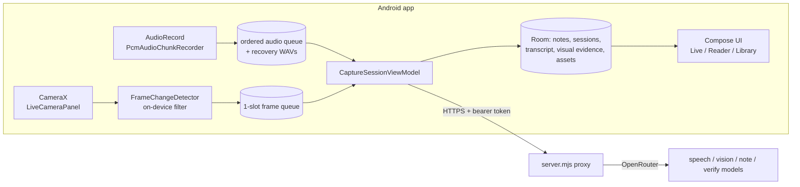

# VoxBox — Developer Guide

VoxBox is an Android app that listens to a lecture (and, in Board mode, watches the board) and
continuously writes structured, evidence-traceable study notes. This guide is for someone who
has to build, run, change or debug it.

- **App:** `VoxBox/` — Kotlin, Jetpack Compose, CameraX, `AudioRecord`, Room. Package `me.thimmaiah.voxbox`.
- **Backend proxy:** `server/` — one dependency-free Node.js file (`server.mjs`) that holds the AI key,
  enforces auth/budgets, validates every model response and forwards to OpenRouter.
- **Hosted at:** `https://voxbox-proxy.onrender.com` (Render, deploys automatically from `main`).
- **Report tooling:** `tools/report-college/` (college-format report), `tools/diagrams/` (figures).

---

## 1. Architecture



Four layers on the device, strictly top-down: **UI** (Compose screens) → **session**
(`CaptureSessionViewModel`, the only orchestrator) → **domain/algorithms** (`audio/`, `board/`,
`reader/` parsing, pure and unit-tested) → **data** (`notes/` Room DAOs and repositories). No
screen touches the database directly, and no algorithm touches Android UI.

The proxy is the trust boundary: the OpenRouter key never reaches the phone. The phone holds only
`VOXBOX_CLIENT_TOKEN`, which is compiled into the APK and therefore **extractable** — it deters
casual abuse; the per-IP rate limit and the daily request budget are the real protection.

### Package map (`VoxBox/app/src/main/java/me/thimmaiah/voxbox/`)

| Package | What lives there |
|---|---|
| `audio/` | `PcmAudioChunkRecorder` (capture, pause-aware chunking, noise gate, WAV), `TranscriptOverlap` (seam repair), `DominantSpeakerTracker`, HTTP transcription client |
| `board/` | `FrameChangeDetector`, `DiagramCropper`, `BoardExtraction` (+ `mergeAdjacentRegions`), ML Kit offline OCR fallback, `SpeechPaceTracker` |
| `camera/` | `VbCameraController` — zoom as source of truth, restored when CameraX reopens |
| `session/` | `CaptureSessionViewModel` (pipeline orchestration, retries, stop/drain, consolidation, verification), live/setup screens, refinement/verification/consolidation HTTP clients |
| `notes/` | Room entities, DAOs, migrations, repositories, Markdown export (Obsidian ZIP) |
| `reader/` | Markdown subset parser (`Markdown.kt`), renderer, built-in diagrams (`Diagrams.kt`, `DiagramView.kt`), review flags |
| `network/` | API config/auth, failure envelope parsing, `NetworkMonitor` + `offlineBackoffMs` |
| `debug/` | `VbDebugLog` — in-app log (opt-in in release) mirrored to logcat tag `VoxBox` |
| `home/ library/ settings/ onboarding/ nav/ ui/` | Screens, navigation, design system |

---

## 2. The live pipeline, end to end

1. **Audio.** One `AudioRecord` (16 kHz mono PCM16, `VOICE_RECOGNITION`, platform noise suppressor
   and AGC when available) is read in a loop. `PcmChunkAccumulator` cuts chunks (§3.1) and
   prepends a 2 s overlap. Each chunk is written atomically to a private **recovery WAV** before
   anything else happens.
2. **Queue.** Chunks go to one unlimited, ordered channel; a single worker processes them in
   lecture order. Frames go to a separate 1-slot drop-oldest channel so a slow board never
   evicts audio.
3. **Transcribe.** `POST /v1/audio/transcribe` → diarized segments. The overlap's repeated words are
   trimmed (§3.3). Segments are persisted as transcript evidence **before** any note work.
4. **Board (Board mode).** Every interval a frame is captured; `FrameChangeDetector` decides on the
   device whether the board changed and settled (§3.2). Only accepted frames go to
   `POST /v1/board/extract` (ML Kit OCR fallback offline). Diagram **crops are taken only from
   frames the student requested with *Capture now***, and adjacent boxes are merged into one crop.
5. **Refine.** `POST /v1/notes/refine` in **delta** mode: the phone sends bounded context (title,
   outline, recent Markdown, a SHA-256 base hash and revision) plus new evidence; the server
   returns Markdown to *append*. Applied only if base hash and revision still match (§3.4).
6. **Delete evidence** (recovery WAV / raw frame) only after the note revision commits.
7. **Stop.** Recorder drains its final partial chunk; queues drain with a 90 s network grace;
   then **consolidation** (§3.7) and **verification** (`/v1/notes/verify`, appended as review
   suggestions, never rewriting the note).

---

## 3. Core algorithms

### 3.1 Pause-aware chunking + adaptive noise gate — `audio/PcmAudioChunkRecorder.kt`
- Every 20 ms frame: RMS energy vs. a running **noise floor**. Floor falls fast to quieter frames
  (`0.7·floor + 0.3·rms`) and rises slowly (`0.999·floor + 0.001·rms`, ≈20 s) so speech over a fan or
  music doesn't drag it up.
- Speech frame: `rms > max(2.0 × floor, 12)` (≈ +6 dB; 12 rules out digital silence only).
- Cut at the first **360 ms** non-speech run once the chunk is ≥ **16 s**; hard ceiling **28 s**.
- `voicedMs` per chunk; chunks with < **400 ms** speech are not transcribed
  (`MIN_VOICED_MS_FOR_TRANSCRIPTION`). `peakRms`/`floorRms` are logged for calibration.
- Lesson from the field test: an absolute loudness floor (previously 120 RMS) classified a whole
  lecture heard from a laptop across the room as silence. Keep the gate **relative**.

### 3.2 On-device frame-change detection — `board/FrameChangeDetector.kt`
Downsample to a 32×32 luminance grid, compensate exposure, score the difference against the
committed baseline, and require the scene to **settle** before accepting (lecturer walking
through ≠ board change). The baseline advances only after the note revision commits, so a failed
upload can be re-observed. Zoom changes reset the reference.

### 3.3 Transcript overlap repair — `audio/TranscriptOverlap.kt`
Chunks overlap by 2 s so no clause is only seen as a fragment; `trimRepeatedPrefix` removes the
longest word-level suffix/prefix match (≥ 3 words) between the previous tail and the new head.

### 3.4 Append-only delta with optimistic revisions — `notes/CaptureSessionDao.kt`, `session/HttpNoteRefinementClient.kt`
`applyGeneratedMarkdownUpdate(sessionId, patchId, expectedRevision, markdown)` applies inside a
transaction only if the stored revision equals `expectedRevision`; duplicate `patchId` is
idempotent; a mismatch is a conflict, never a silent overwrite. Same request id + changed
evidence → HTTP 409 from the proxy.

### 3.5 Grounding guard — `server/server.mjs`
Generated sections whose vocabulary is not supported by the request's evidence are discarded and
reported ("A generated section was discarded…"). Short deltas are exempt (can't be scored fairly).

### 3.6 Offline-safe evidence queue — `CaptureSessionViewModel.keepTryingWhileCapturing`
Retryable failures (timeouts, IO, 5xx, 429, `retryable:true` envelopes) retry with
`offlineBackoffMs`: 0.75 s, 2 s, 4 s, 8 s, 16 s, then 30 s cap — **indefinitely while the session
runs**, waiting on `NetworkMonitor.awaitOnline` when offline. Applies to transcription *and*
refinement, so a transcript captured offline still becomes proper notes. Non-retryable failures
(`daily_budget_exhausted`, auth, validation) stop immediately. After Stop: `STOP_DRAIN_GRACE_MS`
= 90 s, then remaining audio stays as recovery WAVs (Settings → Audio recovery).

### 3.7 End-of-session consolidation — `POST /v1/notes/consolidate`
Live deltas only append, so re-explained topics duplicate. At Stop the session's note (≥ 1,200
chars, ≤ 60,000) is merged once: one `##` heading per topic, a sentence removed only if another
states the same fact, every fact/equation/image/fenced block/callout kept. The proxy **rejects**
results that drop any `` link or shrink below 35 %. The phone saves the pre-merge
Markdown to `filesDir/pre-consolidation/<session>.md`; the transcript stays in Room.

### 3.8 Built-in diagrams — `reader/Diagrams.kt`, `reader/DiagramView.kt`
The note prompt requires a ```` ```mermaid ```` `flowchart TD` (≤ 8 nodes) when evidence describes
a process/transformation, and allows `xychart-beta` for simple numeric trends. The reader parses
a small subset (`A[..] --> B[..]`, `-->|label|`, `{decision}`, chains; `title`, `x-axis [..]`,
`line [..]`, `bar [..]`) and draws natively (flows top-to-bottom; branches listed under the step).
Anything else falls back to a code block. Obsidian renders the same source after export.

### 3.9 Adaptive sampling, speaker focus, camera stability
- `SpeechPaceTracker` retunes frame interval/threshold from measured words per minute (manual
  Tune turns it off).
- `DominantSpeakerTracker`: per-chunk only (≥ 58 % voiced share and 15-point margin); labels are
  not stable across chunks.
- `VbCameraController` keeps the requested zoom and re-applies it from the `ZoomState` observer
  whenever CameraX reopens; camera binding is **not** keyed on the sampling interval. The
  controller's own pinch-zoom is disabled so only one path moves zoom.
- `MainActivity` declares `configChanges` for orientation/size so rotation re-lays out in place
  instead of recreating the activity (which used to end the session).

---

## 4. Backend proxy (`server/`)

| Route | Purpose |
|---|---|
| `GET /health` | Unauthenticated; mode, models, daily budget snapshot |
| `POST /v1/audio/transcribe` | WAV (base64) → diarized segments |
| `POST /v1/board/extract` | Frame → board text, equations, diagram regions |
| `POST /v1/notes/refine` | Evidence → note delta (or full note for legacy clients); idempotent by request id |
| `POST /v1/notes/verify` | Finished note → review findings (never replacement text) |
| `POST /v1/notes/consolidate` | Finished note → merged note (validated) |

Every pipeline route requires `Authorization: Bearer $VOXBOX_CLIENT_TOKEN`, is rate-limited per
caller and counts against the daily budget (mock mode excepted). Errors use one envelope:
`{ "error": { code, message, retryable, retryAfterSeconds? } }` — the app's retry logic keys off
`retryable`.

Environment (`server/.env.example`):

| Variable | Meaning |
|---|---|
| `OPENROUTER_API_KEY` | Provider key (server only, never in the app) |
| `VOXBOX_CLIENT_TOKEN` | Shared bearer token the app presents (≥ 24 chars) |
| `VOXBOX_RATE_LIMIT_MAX` / `_WINDOW_MS` | Per-caller rate limit (default 60 / 60 s) |
| `VOXBOX_DAILY_REQUEST_BUDGET` | Billable requests per day (default 1500) |
| `VOXBOX_{VISION,NOTE,TRANSCRIPTION,VERIFY}_MODEL` | Model overrides (defaults: Gemini flash-lite family) |
| `MOCK_AI=1` | Deterministic mock responses, no provider calls |
| `HOST`, `PORT` | Bind address (default `127.0.0.1:8787`) |

Prompts live in `noteInstructions()`, `callConsolidateProvider()` and `callVerifyProvider()`.
**Completeness rule:** brevity applies to wording, never to facts. The first field test lost ~60 %
of a lecture because the old "concise" prompt treated numbers, names and examples as padding.

---

## 5. Build, run, deploy

```bash
# Backend tests (no network, mocked provider)
cd server && node --test

# Local backend in mock mode, reachable from a USB device
cd server && MOCK_AI=1 node server.mjs
adb reverse tcp:8787 tcp:8787

# Android unit tests / debug build (debug points at http://127.0.0.1:8787)
cd VoxBox && ./gradlew testDebugUnitTest assembleDebug

# Release build against the hosted proxy (token from your secret store, never committed)
cd VoxBox && VOXBOX_API_BASE_URL=https://voxbox-proxy.onrender.com VOXBOX_CLIENT_TOKEN=... \
  ./gradlew assembleRelease -x lintVitalAnalyzeRelease -x lintVitalRelease -x lintVitalReportRelease
adb install -r app/build/outputs/apk/release/app-release.apk
```

- Release builds refuse to configure without an absolute HTTPS URL and a ≥ 24-char token.
- The release APK is signed with the debug keystore for coursework demos — **never publish it**.
- `lintVital*` needs online Gradle artifacts; skip it when building offline.
- Deploy = push to `main`; Render rebuilds the proxy (`render.yaml`, `Dockerfile`). Verify with
  `curl https://voxbox-proxy.onrender.com/health` *and* a request to the route you changed — a
  commit is not a deploy.
- **Rotate `VOXBOX_CLIENT_TOKEN`** whenever an APK containing it has left your hands: set the new
  value on Render, rebuild, reinstall.

---

## 6. Testing and debugging

- **Android JVM tests:** 143 tests / 33 suites (`VoxBox/app/src/test`), covering chunking/noise
  gate, overlap repair, frame detection, delta/hash rules, parsers (Markdown, Mermaid), region
  merging, retry backoff, syllabus import, export.
- **Backend:** 46 tests (`server/test/server.test.mjs`) with a fake `fetch`.
- **Device tests:** opt-in instrumented tests in `VoxBox/app/src/androidTest`.
- **Live diagnosis:** every `VbDebugLog` line is mirrored to logcat:
  ```bash
  adb logcat -v time -s VoxBox:I
  ```
  Useful tags: `[audio]` (voicedMs/peak/floor per chunk), `[transcribe]`, `[offline]` (retries),
  `[refine]` (failures), `[frame]`, `[consolidate]`, `[verify]`, `[tuning]`. Logs carry metadata
  and 60-char previews only, never full transcripts.
- On Windows Git Bash, prefix adb commands that take device paths with `MSYS_NO_PATHCONV=1`.
- **Regexes must be ICU-safe.** Unit tests run on the JVM, which accepts a bare `]` or `}`; Android's
  ICU engine does not, and a failing top-level `Regex` crashes the class on first use. Escape every
  bracket — this is how the built-in diagram parser crashed the reader on its first live note.
- Reading a note's text off a device: `adb shell uiautomator dump` while scrolling the reader.

### Field test record (2026-10-28)
Crash Course *Nuclear Physics #45* (10:24) played from a laptop, phone in Board mode, with noise,
movement, rotation, zoom and ~1 min airplane mode. Ground truth: the video's captions.
Run 1 exposed rotation ending the session, the absolute noise floor skipping every chunk, and the
concise prompt (≈40 % coverage, duplicates unmerged). After fixes, the 5:24–7:04 segment scored
9/12 points (≈75–80 %); consolidation merged 5 repeated topics; verification caught one
transcription-reversed fact. Not yet re-verified: the full video, and offline recovery end to end
on the device.

---

## 7. Known limitations / next work

- Coverage on fast lectures ≈80 %, target 90 %: add a second end-of-session pass over the stored
  transcript to find facts the live deltas missed.
- Speaker identity is per chunk only; persistent lecturer focus needs enrolment/embeddings.
- No on-device ASR; very long outages hold audio until the network returns (bounded by storage).
- Board auto-framing (detect and follow the board/projector) is not implemented; zoom is manual
  but now persistent.
- The client token is extractable from the APK; budgets and rate limits are the real control.

## 8. Regenerating the report

```bash
python tools/report-college/build_report.py            # body.docx from outline.txt + previous report
powershell -File tools/report-college/finish_report.ps1 # adds college starting pages, updates TOC/LoF/LoT, saves .docx + .pdf
```
`outline.txt` maps old report sections into the college's four chapters (`@old 6.4`), holds new
text, and quotes code with `!code path::function | caption`. Formatting rules (A4, TNR, 12/14 pt,
1.5 spacing, justified, margins 1.5/1/1/1 cm, centred page numbers) are applied in
`build_report.py`; the student name, register number and guide are placeholders to fill in Word.
